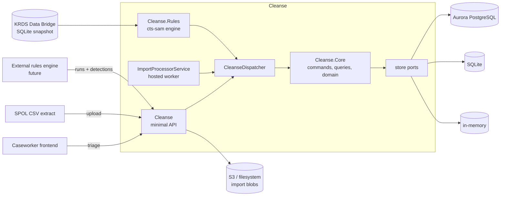

# Cleanse

Cleanse is the backend service for **data quality issue management**. A rules engine detects
anomalies in a dataset and reports them here; Cleanse gives each anomaly a stable identity, tracks
whether it is still being detected, and carries the human triage work — assignment, notes, case
history, suppression and resolution — alongside a complete audit trail.

It is an ASP.NET Core minimal API built for DEFRA's Core Delivery Platform (CDP), running on ECS
Fargate against Aurora PostgreSQL and S3.

- [The problem it solves](#the-problem-it-solves)
- [Key concepts](#key-concepts)
- [Architecture](#architecture)
- [API](#api)
- [Imports](#imports)
- [Rules engine](#rules-engine)
- [Storage providers](#storage-providers)
- [Database migrations](#database-migrations)
- [Running locally](#running-locally)
- [Testing](#testing)
- [Configuration reference](#configuration-reference)
- [Operational notes](#operational-notes)
- [About the licence](#about-the-licence)

---

## The problem it solves

A nightly rules engine re-evaluates every rule and reports whatever it currently sees. On its own
that produces a disposable list: yesterday's triage work is lost, an anomaly that reappears looks
brand new, and there is no record of who did what.

Cleanse keeps the two halves apart:

| Axis | Owner | Values | Changed by |
| --- | --- | --- | --- |
| `IssueStatus` | the machine | `Active`, `Inactive` | the rules engine only, via a run |
| `WorkflowStatus` | a human | `Todo`, `InProgress`, `Suppressed`, `Resolved`, `Ignored`, `Nonactionable` | caseworkers, via the API |

A re-detection never touches the human axis. An issue that was `Resolved` last week and is detected
again tonight comes back as `Active` with its workflow state, assignee, notes and history intact.
When a run completes, every issue in that group which the run did **not** re-detect is swept to
`Inactive` — again without disturbing the human axis.

## Key concepts

**Issue** — the aggregate root. Identified by a caller-supplied natural key (`IssueId`) so that the
same anomaly always upserts onto the same record. `IssueId.Derive("2", cph)` builds collision-free
composite keys of the form `ruleId-digest`, where the digest is a base32 SHA-256 over the
length-prefixed parts. The parts are hashed rather than concatenated because they routinely
contain characters that are illegal in a URL — a CPH's slashes above all — so a derived id is
addressable verbatim and `encodeURIComponent` leaves it untouched. Issues carry a version for
optimistic concurrency, a `Priority` (`Low`/`Medium`/`High`), an assignee, notes, and an ordered
`IssueContext` of supporting key/value data.

An issue also records when it last entered and left the active state. `ActivatedAtUtc` equals
`CreatedAtUtc` on first detection and moves forward on every reactivation; `DeactivatedAtUtc` is
set by the sweep and cleared on reactivation, so it is null exactly while the issue is active.
One anomaly can come and go many times, and only the current pair is kept — the full sequence is
in the audit trail.

**Group** — the unit of scheduling and scoping. A group owns its rules, its runs and its issues.
Only one run and one import may be in flight per group at a time.

**RuleRun** — one pass of a rules engine over one group. States are `Running`, `Completed` and
`Abandoned`; the run accumulates counters for issues created, reactivated, updated and deactivated.

**Audit trail** — append-only, never updated or deleted, keyed by UUIDv7 so it sorts by time.
Records machine-side change (`IssueCreated`, `IssueReactivated`, `IssueWorkflowStatusChanged`,
`IssueSuppressionExpired`, `RunStarted`, `RunCompleted`, …) with field-level before/after values.
Context changes are reported as `context.{key}`.

**Issue history** — separate from the audit trail, and deliberately so. This is *case work*:
`Comment`, `LetterSent`, `PhoneCall`, each with the actor and free-text comments.

**Actor** — who did it. `System` or `Human`, always passed explicitly into Core on every mutating
command, so the domain never depends on ambient identity.

**Suppression** — a time-boxed `Suppressed` workflow state with an expiry. A maintenance sweep
returns issues whose suppression has lapsed and moves them back into the queue.

## Architecture



| Project | Purpose |
| --- | --- |
| `Cleanse` | ASP.NET Core host — minimal API endpoints, authentication, imports, storage selection, OpenAPI, logging. |
| `Cleanse.Core` | The domain. Entities, commands, queries, handlers, DTOs and the store *ports*. Depends only on `Microsoft.Extensions.DependencyInjection.Abstractions` — no ASP.NET, no database, no AWS. |
| `Cleanse.Rules` | The rules engine, as an outer core. Rule abstractions, the registry, the `cts-sam` rules and the run orchestrator. Depends on `Cleanse.Core` and nothing else — no HTTP, no SQLite, no ASP.NET. |
| `Cleanse.Rules.Krds` | The data adapter: the KRDS Data Bridge client and the SQLite snapshot reader. Keeps `HttpClient` and `Microsoft.Data.Sqlite` out of the rules themselves. |
| `Cleanse.Storage.InMemory` | Thread-safe dictionary adapters. Tests and throwaway local runs. |
| `Cleanse.Storage.Sqlite` | File or in-memory SQLite adapter. Default for local development; creates its own schema at startup. |
| `Cleanse.Storage.Postgres` | Npgsql/EF Core adapter for Aurora, with IAM token authentication and a binary `COPY` path for large detection batches. |
| `Cleanse.Core.Test` | Domain, command and query unit tests. |
| `Cleanse.Api.Test` | Full-stack HTTP tests over `WebApplicationFactory<Program>`. |
| `Cleanse.Rules.Test` | Rule, registry and engine tests, plus the KRDS adapter against a real snapshot. |
| `Cleanse.Rules.Harness` | Console app that runs the engine against a real snapshot on a developer machine. |
| `Cleanse.Storage.Sqlite.Test` / `.Postgres.Test` | The shared store conformance suite run against each relational provider, plus provider-specific tests. |
| `Cleanse.Test` | Cross-provider scenario tests — Core against real storage, with no HTTP in the picture. |

### Request flow

Endpoints do no business logic. Issue endpoints bind their request, lift the `Actor` out of the
claims principal, and dispatch a command or query:

1. Endpoint builds an `ICommand<TResult>` or `IQuery<TResult>`.
2. `CleanseDispatcher` resolves the matching handler through a cached generic invoker, so no
   reflection happens per dispatch.
3. The handler talks to store ports and returns `Result<T>` — success, or a `DomainError`.
4. The endpoint maps the result to a status code (`200`, `201`, `202`, `400`, `404`, `409`, `413`).

Mutations take an `ExpectedVersion` and return `409 Conflict` on a mismatch.
The user directory uses `IUserDirectory` for validation, server timestamps and DTO mapping,
over the same storage-port boundary.

## API

Everything lives under `/v1` and requires authentication. `GET /health` and
`GET /v1/openapi.json` are anonymous. The full generated contract is checked in at
[artifacts/openapi/Cleanse.json](artifacts/openapi/Cleanse.json).

### Authentication

Two schemes sit behind a policy scheme that picks per request:

- **API key** — header `x-cleanse-api-key`, compared in constant time. Deliberately *not*
  `x-api-key`, which the CDP ephemeral API Gateway already uses. Set `Auth:ApiKey:Key` as a Portal
  secret; when absent the scheme is not registered at all.
- **JWT (CDP service-to-service)** — AWS STS web identity tokens, validated against the platform's
  JWKS (fetched through the Squid proxy). Restricted to `Auth:Jwt:AllowedServiceNames`. Enabled
  per environment with `Auth__Jwt__Enabled`; issuer and metadata address default to the
  `CDP_JWT_ISSUER` and `CDP_JWT_OIDC_URL` variables CDP injects.

If neither is configured a deny-all handler is registered, so an unconfigured deployment fails
closed rather than open.

### Known users and stable assignments

The backend does not authenticate browser Entra tokens or call Microsoft Graph. `ls-cleanse-ui`
must validate its Entra OIDC login (including signature, issuer, audience, nonce and tenant),
then attest the identity below using its **CDP service-to-service credential**, not the user's
Entra token. Entra enterprise-application assignment controls eligibility; directory membership
only means the user has logged in, not that they still have access.

Both user endpoints and the stable-user assignment path additionally require the authenticated
service name **`ls-cleanse-ui`**, even when the general service allow-list is empty. The normal
allow-list must also permit that service. In **Development only**, the existing
`x-cleanse-api-key` is accepted instead. This is a shared-secret trust boundary: **any local key
holder can attest arbitrary identity claims**, not just the frontend. Do not expose the key to
the browser, run this local mode against production data, or treat a supplied `ClientName` as
proof of frontend identity. API-key callers outside Development are denied these operations
unless the explicit **local Docker only** exception below is enabled.
Existing legacy issue assignment remains available under its original authorization policy.

The local Docker stack intentionally uses Production settings to exercise PostgreSQL/S3 without
loading developer settings. Because it cannot obtain CDP STS tokens, `compose.yml` explicitly sets
`Auth__UserDirectory__AllowLocalApiKey=true` and `Auth__ApiKey__ClientName=ls-cleanse-ui`.
Both settings are required for API-key directory access outside Development; the exception
defaults to **false**, and setting the client name alone does not enable it. A frontend-owned
local backend Compose service must set these same two environment variables, plus its existing
`Auth__ApiKey__Key=local-development-key`. No environment or storage-mode change is needed.
**Never enable `AllowLocalApiKey` in CDP or any deployed environment.** It trusts possession of
the configured key, not an independently proven service identity, and is suitable only for an
isolated local stack. This does not change the default production STS policy.

| Method | Route | Success |
| --- | --- | --- |
| `POST` | `/v1/users/logins` | `200` with the inserted or updated known user. |
| `GET` | `/v1/users?tenantId=...&clientId=...&pageNumber=1&pageSize=50` | `200` with a scoped standard page. |

Login input is `{issuer,subject,tenantId,objectId,clientId,fullName}` (all required strings).
Maximum lengths are respectively **512, 256, 64, 64, 64 and 256** characters; blank values fail
with `400`. Identity strings are exact and case-sensitive, never display-name keys.
The server generates a GUID `id` and UTC timestamps; unknown input fields cannot override them:

```json
{
  "id": "6f3a90c2-7800-46ca-8b90-2476ee23fe6d",
  "issuer": "https://login.microsoftonline.com/tenant/v2.0",
  "subject": "pairwise-subject",
  "tenantId": "tenant",
  "objectId": "object",
  "clientId": "client",
  "fullName": "Alex Example",
  "firstLoggedInAtUtc": "2026-10-27T06:00:00+00:00",
  "lastLoggedInAtUtc": "2026-10-27T06:00:00+00:00"
}
```

The atomic identity key is **`(issuer,clientId,subject)`**. Relogin retains `id` and
`firstLoggedInAtUtc`, refreshes tenant/object/name and advances `lastLoggedInAtUtc` without moving
it backwards. PostgreSQL and file-backed SQLite persist this across restarts. The explicitly
in-memory provider remains ephemeral. Global and group issue resets never delete users.

Directory queries require exact `tenantId` and `clientId`. The response is
`{items,totalCount,pageNumber,pageSize,totalPages}`; `items` contains the user shape above, ordered
by stable user ID. Defaults are page 1 and size 50, maximum size 500. `page` is an alias for
`pageNumber`; conflicting aliases or invalid/overflowing paging return `400`.

The existing `PUT /v1/issues/{id}/assignee` accepts either:

```json
{"userId":"6f3a90c2-7800-46ca-8b90-2476ee23fe6d","tenantId":"tenant","clientId":"client","expectedVersion":1}
```

or legacy `{"assignTo":"legacy text","expectedVersion":1}`. Stable assignment validates that the
GUID is already known in the supplied exact tenant/client scope; unknown or wrong-scope users
return `400` without changing the issue. Both scope fields are also required when `userId` is
explicitly `null` to unassign. Do not mix non-null `assignTo` with `userId`. A scoped request
without an explicit `userId` is rejected rather than treated as legacy unassignment.

Issue responses add nullable `assignedUserId` and `assignedUserFullName`, persisted separately
from legacy `assignedTo`. Stable assignment resolves `assignedTo` and `assignedUserFullName` to
the known user's full name **at assignment time**. Names are display snapshots, not identity;
a later relogin does not rewrite existing issues. Legacy assignment clears the stable-user
fields. Both paths retain optimistic concurrency (`409` on a stale `expectedVersion`),
material-change-only audit/version updates, and preservation across rule re-detection.
See [users.http](users.http) for local requests. Apply Liquibase changeset
`0006-known-users-and-assignments` before deploying; the service never migrates Aurora at startup.
SQLite adds the nullable assignment columns to existing local databases during initialization.

### Issues

| Method | Route | Purpose |
| --- | --- | --- |
| `GET` | `/v1/issues` | Search and page. Filter by group, rule, run, status, workflow status, assignee/unassigned, created/updated date ranges and a free-text term. |
| `GET` | `/v1/issues/{id}` | Fetch one issue. |
| `PUT` | `/v1/issues/{id}/assignee` | Assign, or unassign with `null`. |
| `PUT` | `/v1/issues/{id}/notes` | Replace the internal notes. |
| `PUT` | `/v1/issues/{id}/workflow-status` | Move along the human axis; invalid transitions are rejected. |
| `PUT` | `/v1/issues/{id}/suppression` | Suppress until `ExpiresAtUtc`. |
| `DELETE` | `/v1/issues/{id}/suppression` | Lift a suppression early. |
| `GET` | `/v1/issues/{id}/audit` | System change log. |
| `GET` | `/v1/issues/{id}/history` | Human case actions. |
| `POST` | `/v1/issues/{id}/history` | Record a case action. |

Use `GET /v1/issues?assignedUserId=<guid>` to filter by a stable known-user ID, or
`?unassigned=true` for issues with neither a stable user nor nonblank legacy `assignedTo`.
Legacy text-only assignments remain assigned. With neither filter (or `unassigned=false`),
all assignments are included. Invalid/empty GUIDs, invalid booleans and `unassigned=true`
combined with `assignedUserId` or nonblank `assignedTo` return `400`. Other filters and paging
compose normally; legacy `assignedTo` text filtering remains supported.

Because issue IDs are derived by hashing, they contain only unreserved URL characters and need no
escaping in a route — see
[Cleanse.Api.Test/IssueIdRoutingTests.cs](Cleanse.Api.Test/IssueIdRoutingTests.cs). A detection
carrying an id that is not URL-safe is refused with `400`, because an unaddressable issue would
only fail later, on a request nobody can form.

### Runs

| Method | Route | Purpose |
| --- | --- | --- |
| `POST` | `/v1/runs` | Open a run for a group. One concurrent run per group. |
| `GET` | `/v1/runs` | Run history, newest first. Filter by `groupId` and `state`. |
| `GET` | `/v1/runs/{runId}` | Fetch a run, its counters, its progress and any failure diagnostics. |
| `POST` | `/v1/runs/trigger` | Start the built-in rules engine. Returns `202` with a run id; the run executes in the background. `409` if one is already in flight. |
| `POST` | `/v1/runs/{runId}/cancel` | Ask a running run to stop at its next batch boundary. |
| `POST` | `/v1/runs/{runId}/detections` | Upsert a batch of detections. Capped by `Api:MaxDetectionsPerRequest`; over the limit returns `413` with `detections.batch_too_large`. |
| `POST` | `/v1/runs/{runId}/complete` | Close the run and sweep anything not re-detected to `Inactive`. |
| `POST` | `/v1/runs/{runId}/abandon` | End the run with a reason, and **no** sweep. |
| `GET` | `/v1/runs/{runId}/audit` | Run lifecycle events. |

Abandon exists so that a rules engine which fails part-way through never deactivates issues it
simply did not get to. Failure and cancellation behave the same way for the same reason.

A run carries its own progress, so a caller can watch one without reading the logs:
`currentStage`, `recordsProcessed`, `recordsTotal`, `progressPercent`, `elapsedSeconds`,
`estimatedCompletionAtUtc`, `heartbeatAtUtc`, and on failure `failureMessage` plus the full
`failureDetail` stack dump. Percentage, elapsed time and the projection are derived at read time,
so a running run always reports a current answer.

### Rules

| Method | Route | Purpose |
| --- | --- | --- |
| `GET` | `/v1/rules` | The rule book: every rule in execution order, including those on hold. |

### Groups and maintenance

| Method | Route | Purpose |
| --- | --- | --- |
| `GET` | `/v1/groups` | The groups this deployment knows about. Only `cts-sam` exists today. |
| `GET` | `/v1/groups/{groupId}/summary` | Issue counts by status. |
| `GET` | `/v1/groups/{groupId}/runs/latest` | The most recent run for a group. |
| `POST` | `/v1/maintenance/expire-suppressions` | Sweep lapsed suppressions back into the queue. Intended for a scheduled task. |

### Diagnostics

| Method | Route | Purpose |
| --- | --- | --- |
| `GET` | `/v1/diagnostics` | Database, import storage and KRDS health and read access, issue counts by both axes, and the last reset. |

Built for a status page, so it answers even when the things it reports on do not. Each probe is
independent and returns `ok`, `failed` or `unknown` with a reason; a dependency that is down
produces a `failed` state, not a `500`. Failures are logged at warning so they reach OpenSearch.

| Field | Checks | `target` |
| --- | --- | --- |
| `service` | Not a check: which build answered. `name`, `version` and `environment` (from `SERVICE_VERSION` and `ENVIRONMENT`, which CDP injects into every container; `null` locally), `runtime` and `startedAtUtc`. | — |
| `database` | Counts issues in the issue store. | `host:port/database` |
| `storage` | Where uploaded import files go. On S3 a `HeadBucket` with the service's own credentials, which proves the bucket exists and can be reached without writing anything; in Development the local directory. No bucket configured is `failed`, because every upload is then refused. | The bucket name, or the directory |
| `krds` | For the Data Bridge, a `GET /health` against the bridge's own anonymous health endpoint, sent without the API key. `Healthy` and `Degraded` (both `200`) are `ok`; `Unhealthy` (`503`), any other error status, no answer or no connection is `failed`, and any check the bridge reports as not healthy is named. For a local snapshot, the file on disk. | The bridge's **host name only**, or the snapshot path |
| `krdsAccess` | Whether KRDS can actually be read, as a rule run reads it. For the Data Bridge, `GET /api/etl/staging/sqlite/latest?expiresInMinutes=1` with `Authorization: ApiKey <key>`: `ok` only when the key is accepted and a snapshot is offered for download, and the detail names that snapshot, its size and when it was last modified. A refused key (`401`), no snapshot (`404`, with the bridge's own explanation), any other error, no answer or no key configured is `failed`. The presigned download URL is never downloaded, shown or logged, and is asked for with the shortest lifetime the bridge allows. For a local snapshot, the file is opened read-only, as a run opens it, and its tables are counted. | As `krds` |

The storage and KRDS probes run alongside the database queries and each gives up after 10 seconds,
so one slow dependency cannot run the request into its timeout. The health check can pass while
the access check fails — a bridge that is up but refuses this service's key is exactly the case
the access check exists to catch.

```bash
curl -H 'x-cleanse-api-key: local-development-key' http://localhost:8085/v1/diagnostics
```

To check a deployed environment from the DEFRA network,
[scripts/check-remote-health.ps1](scripts/check-remote-health.ps1) calls `/health` and
`/v1/diagnostics` through CDP's developer ephemeral gateway and reports each as `PASS`, `WARN` or
`FAIL`, exiting `1` on any failure:

```powershell
./scripts/check-remote-health.ps1                         # dev
./scripts/check-remote-health.ps1 -Environment ext-test -ServiceKeyVariable CLEANSE_APIKEY_EXTTEST
```

It sends two keys, read from User environment variables so a renewed key needs no new terminal:
`CDP_EPHEMERAL_GW_KEY`, a developer key from your Portal profile that lasts 24 hours and works only
in the environment it was issued for, and `CLEANSE_APIKEY`, the service's `Auth__ApiKey__Key`
secret for that environment. A `403` means the gateway refused the developer key; a `401` means
cleanse refused its own key. Developer keys are personal, so this is for people, not pipelines.

`lastResetAtUtc` comes from a `data_resets` table that the reset deliberately does not clear —
a table the wipe empties cannot answer when the wipe happened.

## Imports

Caseworkers currently track some of this state in a SharePoint Online list (**SPOL**). The import
pipeline mirrors that state onto issues so the two can be reconciled.

| Method | Route | Purpose |
| --- | --- | --- |
| `POST` | `/v1/imports` | Upload a SPOL CSV extract (multipart `file` + `groupId`, optional paired `tenantId` + `clientId`). Returns `202` with a job to poll. |
| `GET` | `/v1/imports` | List imports, newest first, optionally filtered by group. |
| `GET` | `/v1/imports/{id}` | Status and progress counters. |
| `GET` | `/v1/imports/{id}/rejections` | Rejected rows and non-fatal assignment warnings, with reason codes. |

The extract must carry the columns `CPH`, `Rule No`, `Status`, `Notes`, `Priority` and
`Date Received`; contact columns (`1st`/`2nd`/`3rd Contact Date`, `Letter/email sent`) become
`PhoneCall` and `LetterSent` history entries. The header is validated before a single byte is
persisted.

When the optional `Assigned to` column is present, blank cells clear both legacy and stable
assignment. Nonblank cells are compared after trimming against known users' trimmed full names
using ordinal case-insensitive equality (no fuzzy/email matching). Exactly one named user within
the supplied tenant **and** client scope receives stable assignment. Both scope fields must be
nonempty GUIDs or both omitted; invalid/partial scopes return `400` before file storage. Scope is
persisted with the job, so background workers never infer it or match across tenants/apps.

Nonblank unmatched or ambiguous names retain readable trimmed legacy `assignedTo` and clear any
previous stable user ID/name. The report uses `assignee_unmatched`, `assignee_ambiguous` or
`assignee_scope_missing` (scope omitted) with safe generic details, never names in warning
details/logs. These warnings do **not** reject the issue's other updates, increment `unmatched`,
or fail the job. Report totals count warning/rejection entries, not rejected issues. Missing
`Assigned to` columns preserve existing assignments for compatibility. Duplicate-row collapse
uses the winning row's assignee; repeating unchanged imports does not change issue versions or
duplicate contact history. Issue writes use optimistic version checks to avoid overwriting
concurrent caseworker edits.

Processing is asynchronous. `ImportProcessorService` leases the next `Pending` job atomically,
streams the file from the blob store in batches, applies rows through the dispatcher, and
heartbeats as it goes; a reaper marks jobs whose heartbeat has gone stale as `Abandoned`. Nothing
is inferred from free text — only the columns are believed — and externally-owned fields
(`ExternalNotes`, `ExternalReceivedAtUtc`, `Priority`) are replaced wholesale on each sync rather
than merged.

## Rules engine

Cleanse ships with one rule group, `cts-sam`, which compares holding data between **CTS** (the
legacy cattle tracing system) and **SAM**. It lives in `Cleanse.Rules` as an *outer core*: a
consumer of `Cleanse.Core` in exactly the way the API tier is, dispatching the same commands.
When rules engines are eventually hosted externally they will drive the same `/v1/runs` surface
over HTTP; today the calls are in-process.

| Rule | Error code | Fires when |
| --- | --- | --- |
| `2` | `02` `CTS-CPH-missing-in-Sam` | A CTS open location's CPH is absent from the SAM `Holding` dataset. |
| `1` | `01` `No-cattle-unit-in-Sam` | The SAM holding records no animal species code of `BSN`, `CTT` or `BFF`. |

Rule 2 is the primary rule: when it fires there is no SAM holding to compare against, so every
other rule is necessarily silent for that record. Rule 1 says so itself, through its
precondition, rather than the engine branching on it — which is what lets a rule be added without
editing the engine.

An issue is keyed on the rule number and the CPH, so the same anomaly re-detected
on a later night upserts onto the same record and keeps its triage state. Each issue carries the
rule number, error code, error description and the supporting CTS and SAM fields in its context —
which is where a consumer reads the CPH, since the id itself is opaque.

Slaughterhouses need no special case: CTS files them in the same dataset under a bare number
rather than an `nn/nnn/nnnn` CPH, so restricting the pass to well-formed CPHs excludes them.

### Where the data comes from

The source is the SQLite read model published by the **KRDS Data Bridge**. `Rules:Krds:Provider`
selects how it is obtained:

- `DataBridge` — `GET /api/etl/staging/sqlite/latest` with `Authorization: ApiKey <key>` returns a
  presigned URL, which is then downloaded to scratch space and deleted after the run. The
  presigned URL is already authenticated and is fetched **without** the header.
- `LocalFile` — opens a snapshot already on disk, read-only and in place. The Data Bridge is not
  reachable from a developer machine, so this is the local path.

SQLite needs random access to a real file and cannot read a snapshot from a `Stream`, which is why
the deployed path downloads rather than streams. The whole pass is one query — CTS open locations
left-joined to SAM holdings, with species codes from a correlated subquery — so it costs a single
scan rather than a query per holding.

### Scheduling and concurrency

A run starts daily at `Rules:DailyRunAtUtc` (01:00 UTC), and on demand through
`POST /v1/runs/trigger`. Every instance schedules independently: the loser of the race is refused
by the one-run-per-group constraint and logs the fact, which is less to go wrong than leader
election. A run that stops heartbeating — because its process died — is abandoned by a reaper
after `Rules:StaleAfter`, so a dead run cannot hold its group's slot forever.

## Storage providers
`Storage:Provider` selects one of `InMemory`, `Sqlite` or `Postgres`. **Outside `Development` only
Postgres is permitted** — startup refuses anything else rather than let a deployed service look
healthy on SQLite and lose every issue on the next container recycle.

The ports (`IIssueStore`, `IRuleRunStore`, `IAuditStore`, `IIssueHistoryStore`, `IImportJobStore`,
`IImportFileStore`) are deliberately declarative rather than `IQueryable`, so every provider can
honour the identical surface and is held to it by the same shared conformance suite. Notable
operations:

- `SaveAsync(issue, expectedVersion)` — optimistic concurrency.
- `DeactivateStaleAsync(groupId, runId)` — the end-of-run sweep, set-based, one audit row for the
  whole sweep rather than one per issue.
- `LeaseNextPendingAsync()` — atomic `Pending` → `Processing` transition for the import worker.

## Database migrations

The running service has **no DDL rights and never migrates**. Schema is applied by Liquibase from
[changelog/db.changelog.xml](changelog/db.changelog.xml), which CDP runs on CodeBuild as the
`ls_cleanse_api_ddl` user via *Portal → Apply Changelog*.

The SQL files are generated from EF Core migrations, not hand-written:

```bash
dotnet dotnet-ef migrations add <Name> --project Cleanse.Storage.Postgres --output-dir Schema/Migrations
dotnet dotnet-ef migrations script --idempotent --project Cleanse.Storage.Postgres \
    --output changelog/sql/<nnnn>_<name>.sql
```

Published changesets are immutable. To change the schema, add a new migration **and** a new
changeset; never edit one that has already been applied.

## Running locally

Requires the **.NET 10 SDK**, and Docker if you want Postgres or want to run the Postgres tests.

### Directly

```bash
dotnet run --project Cleanse --launch-profile Cleanse
```

Serves on `http://localhost:8085` with the `Development` settings: SQLite at `cleanse.local.db`,
imports written to a local temp directory, JWT off, the API key `local-development-key`, and the
rules engine enabled against the KRDS snapshot named in
[appsettings.Development.json](Cleanse/appsettings.Development.json).

```bash
curl http://localhost:8085/health
curl -H 'x-cleanse-api-key: local-development-key' http://localhost:8085/v1/issues
```

The database starts empty. Trigger a run to populate it:

```bash
curl -XPOST localhost:8085/v1/runs/trigger -H 'x-cleanse-api-key: local-development-key'
```

Changing the issue key scheme invalidates an existing `cleanse.local.db`; delete it and re-run.

### With Docker

[dev-docker-up.ps1](dev-docker-up.ps1) brings the service up the way it is deployed:
`ASPNETCORE_ENVIRONMENT=Production`, Postgres with the two-role (DDL/DML) model, Liquibase
applying the changelog, and Floci emulating S3. It builds the image, waits until every container
is healthy, checks that the API answers, and prints the URLs and keys. It runs on PowerShell 7 and
on Windows PowerShell 5.1.

```powershell
./dev-docker-up.ps1                        # build, start, wait, smoke check
./dev-docker-up.ps1 -NoBuild               # restart without rebuilding the image
./dev-docker-up.ps1 -KrdsSnapshot <path>   # also run the rules engine against a local snapshot
./dev-docker-up.ps1 -Reset                 # start from an empty database
./dev-docker-up.ps1 -Follow                # then follow the service's logs, readably
./dev-docker-up.ps1 -Down                  # stop; add -Reset to delete the database as well
```

| Service | Purpose |
| --- | --- |
| `postgres` | Aurora stand-in on `localhost:5432`. Owner role `ls_cleanse_api_ddl`, service role `ls_cleanse_api`; each password is its role name. |
| `liquibase` | One-shot. Applies `changelog/` as `ls_cleanse_api_ddl` and exits; the API waits for it to succeed. |
| `floci` | AWS emulator ([floci.io](https://floci.io)) on `localhost:4566`, providing the `cleanse-imports` S3 bucket. |
| `cleanse` | This service, on `http://localhost:8085`, with the API key `local-development-key` and the reset key `local-development-reset-key`. |

The database lives in a Docker volume and survives restarts. The rules engine stays off unless a
snapshot is supplied, through `-KrdsSnapshot` or `$env:CLEANSE_KRDS_SNAPSHOT`; it is then mounted
read-only by [compose.krds.yml](compose.krds.yml). `ls-cleanse-ui` defaults to
`http://localhost:8085` and the same API key, so its `dev-up.ps1` works against this stack as it
is.

Move the host ports with `CLEANSE_PORT`, `CLEANSE_POSTGRES_PORT` and `CLEANSE_FLOCI_PORT`, for
instance when another stack already holds 4566. The script checks them before starting anything
and names whatever holds them. Plain `docker compose up --build -d --wait` works too; the script
adds the checks around it.

Two details of the stack are easy to undo by accident:

- Shell scripts under `compose/` run inside Linux containers, so [.gitattributes](.gitattributes)
  keeps them LF. A clone made before that rule may still hold CRLF copies, which the script
  converts.
- The AWS SDK addresses buckets by hostname (`cleanse-imports.floci`), as it does against real
  S3, so Floci runs with `FLOCI_HOSTNAME=floci` and a network alias per bucket. A new bucket needs
  both an `aws s3 mb` line in `compose/floci/start.d` and an alias in `compose.yml`.

A richer platform-like environment is available in
[DEFRA/cdp-local-environment](https://github.com/DEFRA/cdp-local-environment).

## Testing

xUnit v3, with NSubstitute where a port needs faking. There is no mocking of the domain — the
store conformance suite and the API tests run against real implementations.

```bash
dotnet test                                     # everything
dotnet test Cleanse.Core.Test                   # domain, commands, queries
dotnet test Cleanse.Api.Test                    # HTTP, auth, limits, imports
dotnet test Cleanse.Rules.Test                  # rules, the engine, the KRDS adapter
dotnet test Cleanse.Storage.Sqlite.Test         # relational conformance, no Docker needed
dotnet test Cleanse.Storage.Postgres.Test       # same suite on real Postgres via Testcontainers
dotnet test Cleanse.Test                        # cross-provider scenarios
```

The Postgres suite starts a container through Testcontainers, so Docker must be running. It lays
the database out as CDP does: `ls_cleanse_api_ddl` applies the changelog, grants included, and the
stores connect as the DML-only `ls_cleanse_api` role, so a store that needs more rights than the deployed
service has fails here first. Without Docker the suite skips, except where `CI=true` (GitHub
Actions sets it) or `CLEANSE_REQUIRE_DOCKER=true`, where it fails instead, so a pipeline cannot
pass without having run it. The image build runs `dotnet test Cleanse.Test` and
`dotnet test Cleanse.Rules.Test` as a build stage.

Rules are pure functions over a context, so they are tested directly with no I/O at all. The
engine is tested over real Core and the in-memory provider with only the data source faked. A
small number of tests in `Cleanse.Rules.Test` read a real KRDS snapshot and assert exact counts;
they skip themselves where no snapshot is present.

`Cleanse.Rules.Harness` runs the engine end to end against a real snapshot, persisting to a
throwaway SQLite database, and prints live progress:

```bash
dotnet run --project Cleanse.Rules.Harness
dotnet run --project Cleanse.Rules.Harness -- <snapshot.sqlite> <cleanse.db> --keep
```

The same thing through the API, which also exercises the background worker:

```bash
cd Cleanse && dotnet run
curl -XPOST localhost:8085/v1/runs/trigger -H 'x-cleanse-api-key: local-development-key'
curl 'localhost:8085/v1/runs?groupId=cts-sam' -H 'x-cleanse-api-key: local-development-key'
```

The OpenAPI document is generated at build time into
[artifacts/openapi/Cleanse.json](artifacts/openapi/Cleanse.json). Generation **executes the host**,
so nothing in startup may throw on missing deployment configuration — that is why unconfigured
dependencies register fail-closed stubs and raise a `StartupWarnings` entry instead.

### Secrets

Non-sensitive configuration lives in `cdp-app-config`; secrets go through the CDP Portal.
[scripts/generate-secrets.ps1](scripts/generate-secrets.ps1) generates every secret this service
and `ls-cleanse-ui` need, in one pass, so that the values which must agree across the two actually
do:

```powershell
./scripts/generate-secrets.ps1 -Environment dev -IncludeExternal
```

| Secret | Service | Notes |
| --- | --- | --- |
| `Auth__ApiKey__Key` | `cleanse` | Must equal the frontend's `CLEANSE_API_KEY`. |
| `Auth__Reset__Key` | `cleanse` | Guards the destructive reset. Leave unset to disable it. |
| `Rules__Krds__ApiKey` | `cleanse` | Issued by the KRDS team, not generated. The status page's KRDS read access check shows whether the bridge accepts it. |
| `SESSION_COOKIE_PASSWORD` | `ls-cleanse-ui` | At least 32 characters. |
| `CLEANSE_API_KEY` | `ls-cleanse-ui` | Only used when the frontend is set to key auth; the deployed default is an STS web identity token, which needs no secret. |
| `PASSWORD` | `ls-cleanse-ui` | The password everyone signs in to the frontend with. Until it is set, nobody can sign in. |
| `ADMIN_PASSWORD` | `ls-cleanse-ui` | The second password the frontend's `/admin` area asks for. Until it is set, the admin area cannot be opened. |

## Configuration reference

Standard ASP.NET Core binding: `appsettings.json`, then environment overrides, then environment
variables with `__` for nesting (`Storage__Postgres__Host`). Production values come from
`cdp-app-config`; secrets from the CDP Portal.

### `Api`

| Key | Default | Meaning |
| --- | --- | --- |
| `MaxDetectionsPerRequest` | `1000` | Detections accepted per batch before `413`. |
| `RequestTimeoutSeconds` | `25` | Returns `504`. Sits just inside API Gateway's 29s integration timeout. |
| `MaxRequestBodyBytes` | `10485760` | 10 MB, excluding import uploads. |

### `Auth`

| Key | Default | Meaning |
| --- | --- | --- |
| `ApiKey:Key` | *(unset)* | Shared secret for the `x-cleanse-api-key` header. Scheme disabled when absent. |
| `ApiKey:ClientName` | `api-key-client` | Actor recorded for key-authenticated changes. |
| `Jwt:Enabled` | `false` | Turn on per environment. |
| `Jwt:Audience` | `ls-cleanse-api` | Chosen by us; must match on both caller and receiver. |
| `Jwt:Issuer` | from `CDP_JWT_ISSUER` | |
| `Jwt:MetadataAddress` | from `CDP_JWT_OIDC_URL` | JWKS discovery, fetched via the Squid proxy. |
| `Jwt:AllowedServiceNames` | `["ls-cleanse-ui"]` | Empty means any service in the environment may call. |

### `Storage`

| Key | Default | Meaning |
| --- | --- | --- |
| `Provider` | `Postgres` (`Sqlite` in Development) | `InMemory`, `Sqlite` or `Postgres`. |
| `Postgres:Host` / `Port` / `Database` / `Username` | `localhost` / `5432` / `ls_cleanse_api` / `ls_cleanse_api` | Writer endpoint and DML user. |
| `Postgres:UseIamAuthentication` | `true` | Mints a short-lived IAM token per connection. |
| `Postgres:LocalPassword` | *(unset)* | Local development only; required when IAM auth is off. |
| `Postgres:Region` | `eu-west-2` | |
| `Postgres:ConnectionTimeoutSeconds` | `30` | Aurora Serverless v2 needs 2–9s to wake. |
| `Postgres:CommandTimeoutSeconds` | `60` | |
| `Postgres:MaxPoolSize` | `20` | |
| `Postgres:CopyThreshold` | `100` | Rows above which inserts switch to binary `COPY`. |
| `Postgres:ReadOnlyHost` | *(unset)* | Configured but unused — replica lag on the read-before-write detection path would create duplicates. |
| `Sqlite:DataSource` | `cleanse.db` | |

### `Imports`

| Key | Default | Meaning |
| --- | --- | --- |
| `S3BucketName` | *(unset)* | Required outside Development; uploads are rejected until set. |
| `FileStoreRoot` | temp dir | Development only. |
| `BatchSize` | `500` | Rows applied per command. |
| `MaxUploadBytes` | `52428800` | 50 MB. |
| `PollInterval` | `00:00:05` | Worker poll for pending jobs. |
| `StaleAfter` | `00:10:00` | Heartbeat gap after which the reaper abandons a job. |
| `MaxRejectionsRecorded` | `1000` | Caps the stored reconciliation report. |

### `Rules`

| Key | Default | Meaning |
| --- | --- | --- |
| `Enabled` | `false` | Starts the nightly schedule and the background workers. Off by default so a build or a test host never fires a run. |
| `GroupId` | `cts-sam` | The group every run is scoped to. |
| `DailyRunAtUtc` | `01:00:00` | Time of day, in UTC. Does not shift with British Summer Time. |
| `BatchSize` | `500` | Records evaluated between flushes. Also the progress reporting interval. |
| `StaleAfter` | `00:15:00` | Heartbeat gap after which a run is presumed dead and abandoned. |
| `Krds:Provider` | `DataBridge` | `DataBridge` or `LocalFile`. |
| `Krds:LocalFilePath` | *(unset)* | Required for `LocalFile`. |
| `Krds:BaseUrl` | *(unset)* | Required for `DataBridge`, e.g. `https://ls-keeper-data-bridge-backend.dev.cdp-int.defra.cloud`. `/v1/diagnostics` pings its `/health`, reads its latest snapshot with the key, and shows only its host name. |
| `Krds:ApiKey` | *(unset)* | The **bare** key; the `ApiKey` scheme is added by the client. A Portal secret. |
| `Krds:DownloadUrlExpiryMinutes` | `30` | Presigned URL lifetime. The Data Bridge caps this at 60. |
| `Krds:DownloadTimeout` | `00:20:00` | The snapshot runs to the better part of a gigabyte. |
| `Krds:ScratchDirectory` | temp dir | Where downloaded snapshots are written, then deleted. |

### Core and host
| Key | Default | Meaning |
| --- | --- | --- |
| `DetectionBatchSize` | `500` | Detections read, merged and written per round trip. |
| `SuppressionExpiryBatchSize` | `500` | |
| `MaxSuppressionExpiryBatches` | `100` | Caps one sweep so a backlog cannot spin forever. |
| `TraceHeader` | `x-cdp-request-id` | Propagated onto outbound calls. |

## Operational notes

- **Health check** — `GET /health` is **liveness only**, with no dependency probes. A cold Aurora
  cluster takes 2–9 seconds to answer and the platform kills the container after three 5-second
  timeouts, so a database probe here would cause restart loops.
- **Logging** — Serilog in Elastic Common Schema format for CDP's OpenSearch. Never write to
  stderr during startup: MSBuild treats it as an error during build-time OpenAPI generation.
  The console sink is declared under `Serilog:WriteTo` in `appsettings.json`, and `CdpLogging`
  builds the main logger from that section alone, so without it the service writes nothing at
  all. `Serilog:MinimumLevel` is applied to the root logger as well, the only place Serilog
  honours its overrides; EF Core is held at `Warning` so the import worker's polling stays quiet.
- **Startup warnings** — non-fatal misconfiguration (JWT disabled while `CDP_JWT_ISSUER` is
  present, no import bucket) is collected during DI and logged once the logger is up, rather than
  thrown.
- **Egress** — outbound HTTP goes through the Squid proxy via `ProxyHttpMessageHandler`, including
  the JWKS fetch. A custom trust store is loaded before anything opens a connection.
- **Port** — the container listens on `8085`, as CDP requires.

## About the licence

The Open Government Licence (OGL) was developed by the Controller of Her Majesty's Stationery Office (HMSO) to enable
information providers in the public sector to license the use and re-use of their information under a common open
licence.

It is designed to encourage use and re-use of information freely and flexibly, with only a few conditions.
